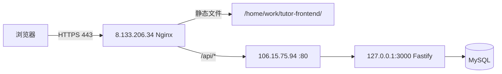

# tutor-platform 生产发布

> 结构与 `Desktop/api-service/生产发布快捷命令.md` 对齐（tar/scp、不含 `.env`、权限与 nginx -t）。  
> 打包**不含** `.env`，服务器上已有配置不会被覆盖。

## 架构概览

| 组件 | 公网 IP / 域名 | 目录 / 端口 | 说明 |
|------|----------------|-------------|------|
| 前端 Nginx + 静态 SPA | **8.133.206.34** · `https://www.tutor-platform.zhiyouyue.top` | `/home/work/tutor-frontend/` · 443 | 仓库根目录 [`nginx.conf`](../../nginx.conf) 中 `tutor_platform_backend` 段 |
| 后端 API（Fastify） | **106.15.75.94** · `:80`（Nginx 反代）→ `:3000`（Node） | `/home/work/tutor-platform-backend/` | 前端 Nginx `location /api/` 反代到此机 **80** 端口 |
| MySQL | 通常与后端同机或内网 | — | 账号见 `backend/.env` 的 `MYSQL_*` |



**前端构建约定**：生产环境**不要**设置 `VITE_API_URL`（或设为空），浏览器走同源 `/api/...`，由 8.133.206.34 的 Nginx 反代到后端。

**CORS**：后端 `CORS_ORIGIN=https://www.tutor-platform.zhiyouyue.top`（与正式域名一致）。

---

## 0. 发布前本地检查（Windows）

在项目根目录 `tutor-platform-harness`：

```powershell
cd "c:\Users\Administrator\Desktop\职优越导师平台\tutor-platform-harness"
npm ci
npm run test -w backend
npm run build -w backend
npm run build -w frontend
```

前端产物：`frontend/dist/` → §3.2 打 `tutor-frontend-dist.tgz` 或 §3.3 直传，解压/同步到 `/home/work/tutor-frontend/`（不要多一层 `dist`）。

---

## 1. 后端打包上传（106.15.75.94）

在**本地仓库根目录**执行。包含 `backend/src`、`backend/dist`（若已 build）、`backend/package.json`、根 `package.json` / `package-lock.json`（workspace 安装需要），**不含** `node_modules`、`.env`、`.git`。

### Git Bash（Windows 一行）

先本地构建后端：

```bash
cd /c/Users/Administrator/Desktop/职优越导师平台/tutor-platform-harness && npm run build -w backend && tar -czf tutor-backend-deploy.tgz --exclude='node_modules' --exclude='.git' --exclude='frontend' --exclude='core' --exclude='.env' --exclude='backend/.env' --exclude='**/__pycache__' backend package.json package-lock.json deploy/run_backend.sh deploy/nginx/tutor-backend.conf && scp tutor-backend-deploy.tgz root@106.15.75.94:~/
```

### PowerShell（分步）

```powershell
cd "c:\Users\Administrator\Desktop\职优越导师平台\tutor-platform-harness"
npm run build -w backend
tar -czf tutor-backend-deploy.tgz `
  --exclude=node_modules --exclude=.git --exclude=frontend --exclude=core `
  --exclude=.env --exclude=backend/.env `
  backend package.json package-lock.json deploy/run_backend.sh deploy/nginx/tutor-backend.conf
scp tutor-backend-deploy.tgz root@106.15.75.94:~/
```

上传成功应看到：`tutor-backend-deploy.tgz  100%  ...`

---

## 2. 后端服务器解压、依赖、数据库、启动

```bash
ssh root@106.15.75.94

mkdir -p /home/work/tutor-platform-backend
cd /home/work/tutor-platform-backend

# 首次：从示例复制环境变量并编辑（勿覆盖已有 .env）
# cp backend/.env.example backend/.env && vim backend/.env

tar -xzf ~/tutor-backend-deploy.tgz -C /home/work/tutor-platform-backend
# 若 run_backend.sh 报 $'\r': command not found：
# sed -i 's/\r$//' deploy/run_backend.sh

chown -R work:work /home/work/tutor-platform-backend

# 安装依赖（在仓库根，workspace）
sudo -u work bash -lc 'cd /home/work/tutor-platform-backend && npm ci --omit=dev'
sudo -u work bash -lc 'cd /home/work/tutor-platform-backend && npm run build -w backend'

# 数据库迁移（按需、首次或版本升级；在 backend 目录用 tsx）
sudo -u work bash -lc 'cd /home/work/tutor-platform-backend/backend && npx tsx scripts/run-sql.ts sql/07_phase3_appointments_notifications.sql'
# 新环境还需：00 → 01 → 02 → … 见 backend/sql/README 或 DEPLOYMENT-CHECKLIST

# 后端 Nginx（首次或变更 deploy/nginx/tutor-backend.conf 时）
cp deploy/nginx/tutor-backend.conf /etc/nginx/sites-available/tutor-platform-backend.conf
ln -sf /etc/nginx/sites-available/tutor-platform-backend.conf /etc/nginx/sites-enabled/
nginx -t && systemctl reload nginx

# 启动 / 重启 Node
sudo -u work bash deploy/run_backend.sh
```

**`backend/.env` 生产必填项（摘要）** — 详见 [`backend/.env.example`](../../backend/.env.example) 与 [`phase-3/DEPLOYMENT-CHECKLIST.md`](../product-specs/phase-3/DEPLOYMENT-CHECKLIST.md)：

| 变量 | 说明 |
|------|------|
| `PORT=3000` `HOST=0.0.0.0` | 仅本机监听，对外由 Nginx :80 暴露 |
| `CORS_ORIGIN=https://www.tutor-platform.zhiyouyue.top` | 正式前端域名 |
| `JWT_SECRET` | 强随机，勿用默认值 |
| `MYSQL_*` | 生产库账号 |
| `ALIYUN_RTC_*` / `OSS_*` | 音视频与文件（按功能启用） |

---

## 3. 前端发布（8.133.206.34）

Nginx 为 `root /home/work/tutor-frontend/;`，线上应是 **`index.html` 与 `assets/` 同级**，不要多一层 `dist/`。

### 3.1 本地构建

**PowerShell**

```powershell
cd "c:\Users\Administrator\Desktop\职优越导师平台\tutor-platform-harness"
# 生产：不设置 VITE_API_URL，浏览器走同源 /api
Remove-Item Env:VITE_API_URL -ErrorAction SilentlyContinue
npm run build -w frontend
# 产物：frontend/dist/
```

**Git Bash**

```bash
cd /c/Users/Administrator/Desktop/职优越导师平台/tutor-platform-harness
unset VITE_API_URL
npm run build -w frontend
```

### 3.2 打包（tar）

在 `frontend/dist/` 已生成后，把 **dist 内文件** 打进包（解压后直接是站点根）：

```bash
cd /c/Users/Administrator/Desktop/职优越导师平台/tutor-platform-harness/frontend
tar -czf tutor-frontend-dist.tgz -C dist .
ls -lh tutor-frontend-dist.tgz
```

**构建 + 打包 + scp（Git Bash 一行）**

```bash
cd /c/Users/Administrator/Desktop/职优越导师平台/tutor-platform-harness && unset VITE_API_URL && npm run build -w frontend && cd frontend && tar -czf tutor-frontend-dist.tgz -C dist . && scp tutor-frontend-dist.tgz root@8.133.206.34:~/
```

### 3.3 上传到服务器

**方式 A — tgz（与 §3.2 配套，推荐）**

```bash
ssh root@8.133.206.34 "mkdir -p /home/work/tutor-frontend"
ssh root@8.133.206.34 "tar -xzf ~/tutor-frontend-dist.tgz -C /home/work/tutor-frontend"
```

**方式 B — rsync（已 build，不打 tar）**

```bash
cd /c/Users/Administrator/Desktop/职优越导师平台/tutor-platform-harness/frontend
ssh root@8.133.206.34 "mkdir -p /home/work/tutor-frontend"
rsync -avz --delete dist/ root@8.133.206.34:/home/work/tutor-frontend/
```

**方式 C — scp（无 rsync 时）**

```bash
cd /c/Users/Administrator/Desktop/职优越导师平台/tutor-platform-harness/frontend
scp -r dist/* root@8.133.206.34:/home/work/tutor-frontend/
```

### 3.4 静态目录权限（每次上传后）

Nginx 常以 `www-data` 运行，需能读 `/home/work/tutor-frontend/`：

```bash
ssh root@8.133.206.34

chmod o+x /home/work
chmod o+x /home/work/tutor-frontend
chown -R work:www-data /home/work/tutor-frontend
chmod -R g+rX /home/work/tutor-frontend

sudo -u www-data test -r /home/work/tutor-frontend/index.html && echo OK || echo FAIL
```

### 3.5 前端 Nginx（首次或变更时）

仓库 [`nginx.conf`](../../nginx.conf) 已包含：

- `upstream tutor_platform_backend { server 106.15.75.94:80; }`
- `www.tutor-platform.zhiyouyue.top` 的 80→301、443 SPA + `location /api/`

更新到 **8.133.206.34**（若该文件即整机主配置）：

```bash
# 本地
scp nginx.conf root@8.133.206.34:/etc/nginx/nginx.conf

# 服务器
nginx -t && systemctl reload nginx
```

**安全组**：公网放行 443；106.15.75.94 的 **80** 建议仅允许 8.133.206.34（及运维 IP）访问，**不要**对公网开放 3000。

---

## 4. 发布后验证

### 4.1 在后端机 106.15.75.94

```bash
pgrep -af "node dist/server.js"
curl -s -o /dev/null -w "health: %{http_code}\n" http://127.0.0.1:3000/api/v1/health
curl -s -o /dev/null -w "via nginx: %{http_code}\n" http://127.0.0.1/api/v1/health
tail -f /home/work/tutor-platform-backend/backend/nohup_backend.out
```

### 4.2 在前端机或通过域名

```bash
curl -sI https://www.tutor-platform.zhiyouyue.top/ | head -5
curl -s -o /dev/null -w "api health: %{http_code}\n" https://www.tutor-platform.zhiyouyue.top/api/v1/health
```

浏览器：打开 `https://www.tutor-platform.zhiyouyue.top` → 登录页 → 各角色冒烟（见 [`DEPLOYMENT-CHECKLIST.md`](../product-specs/phase-3/DEPLOYMENT-CHECKLIST.md) §4）。

### 4.3 日志

| 位置 | 说明 |
|------|------|
| `8.133.206.34` `/var/log/nginx/error.log` | 前端反代、静态 404/500 |
| `106.15.75.94` `backend/nohup_backend.out` | Fastify 标准输出 |
| `106.15.75.94` `/var/log/nginx/error.log` | 后端 Nginx |

---

## 5. 日常更新速查

| 更新内容 | 操作 |
|---------|------|
| 仅后端 | §1 打包上传 → §2 解压 → `npm ci` → `npm run build -w backend` → `deploy/run_backend.sh` |
| 仅前端 | §3.1 构建 → §3.2 打 `tutor-frontend-dist.tgz` → §3.3 上传/解压 → §3.4 权限 |
| 后端 + 前端 | 先后端 §1§2，再前端 §3 |
| Nginx / 证书 | 更新 [`nginx.conf`](../../nginx.conf) 或后端 `deploy/nginx/tutor-backend.conf` → `nginx -t && systemctl reload nginx` |
| 数据库增量 | SSH 后端机 → `npx tsx scripts/run-sql.ts sql/0x_*.sql` |

---

## 6. 与 api-service 发布习惯对照

| api-service | tutor-platform |
|-------------|----------------|
| `python scripts/deploy_prod_backend_only.py` | 暂无一键脚本；可用 §1–§2 手工 tar/scp，或后续加 `scripts/deploy_prod.py` |
| 不含 `.env` 的 `*.tgz` | 同样：`tutor-backend-deploy.tgz` 不含 `backend/.env` |
| `scp -r dist` + `chmod o+x /home/work` | 前端同样；注意 `root` 指向 **`tutor-frontend/`** 而非 `dist/` 子目录 |
| `run_api.sh` 重启 | `deploy/run_backend.sh` 重启 Node |

---

## 7. 故障排查

| 现象 | 可能原因 | 处理 |
|------|----------|------|
| 前端 200，API 502/504 | 后端未启动或安全组未放行 8.133→106:80 | §2 启动进程；检查阿里云安全组 |
| API 404 | 反代路径错误 | 确认 Fastify 前缀为 `/api/v1`；Nginx `location /api/` 未去掉前缀 |
| 静态 500 Permission denied | www-data 无法读 `/home/work` | §3.4 |
| CORS 错误 | `CORS_ORIGIN` 与浏览器 Origin 不一致 | 设为 `https://www.tutor-platform.zhiyouyue.top` |
| 上传大文件失败 | body 限制 | 前后端 Nginx 均已 `client_max_body_size 100m` |

---

**相关文档**：[`docs/product-specs/phase-3/DEPLOYMENT-CHECKLIST.md`](../product-specs/phase-3/DEPLOYMENT-CHECKLIST.md)
