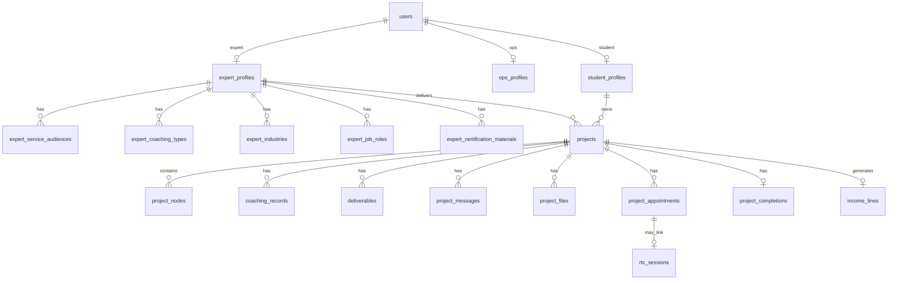

# Phase 1 功能 ↔ 表设计对照（v1.0 已确认）

- **日期**: 2025-09-14
- **数据库**: `expert_platform`（MySQL 8.0+，独立库）
- **DDL**: `backend/sql/01_phase1_schema.sql` + `02_seed_dictionaries.sql`
- **依据**: [PRD v1.0](../PRD-20250914-phase1-master.md) · Figma 前端 · PO 确认

---

## 0. 命名统一

| 角色 | API / 前端 | `users.role` | 档案表 |
|------|------------|--------------|--------|
| 专家 | `expert` | `expert` | `expert_profiles` |
| 运营 | `ops` | `ops` | `ops_profiles` |
| 管理员 | `admin` | `admin` | — |
| 学员 | `student` | `student` | `student_profiles` |

> 不再使用 `mentor` / `supervisor` / `orders`。Phase 1 业务实体为 **`projects`**。

---

## 1. PO 确认决策（2025-09-14）

| # | 问题 | 结论 |
|---|------|------|
| 1 | 旧 orders 模型 | **完全不走**；无 orders 相关表 |
| 2 | 角色枚举 | DB/API **统一** `expert` / `ops` |
| 3 | 能力资产 | **4 张关联表**（非 JSON） |
| 4 | 认证材料 | 独立 **`expert_certification_materials`** |
| 5 | RTC 关联 | `rtc_sessions.appointment_id` → `project_appointments` |
| 6 | 字典表 | **固定 seed**，admin 不可后台配置 |

---

## 2. ER 概览



---

## 3. 表清单（28 张）

### 3.1 账号与会话

| 表 | 模块 |
|----|------|
| `users` | 全角色账号（role: admin/expert/ops/student） |
| `user_sessions` | Refresh token |
| `login_logs` | 登录审计 |
| `student_login_tokens` | 学员 OTP / Magic Link |

### 3.2 档案

| 表 | 模块 |
|----|------|
| `expert_profiles` | 专家资料 + 认证状态 |
| `ops_profiles` | 运营档案 |
| `student_profiles` | 学员基础 |
| `student_career_profiles` | 学员求职档案 |
| `expert_payment_info` | 收款信息（V1 展示） |
| `expert_certification_materials` | 认证材料 OSS |
| `expert_availability_slots` | 可辅导时段 |
| `expert_availability_blackouts` | 临时不可用 |

### 3.3 字典 + 能力关联

| 表 | 说明 |
|----|------|
| `dict_service_audiences` | 服务人群（seed） |
| `dict_coaching_types` | 辅导内容（seed） |
| `dict_industries` | 行业（seed） |
| `dict_job_roles` | 岗位（seed） |
| `expert_service_audiences` | 专家 ↔ 人群 |
| `expert_coaching_types` | 专家 ↔ 辅导类型 |
| `expert_industries` | 专家 ↔ 行业 |
| `expert_job_roles` | 专家 ↔ 岗位 |

### 3.4 项目交付

| 表 | 模块 |
|----|------|
| `projects` | 项目主表（运营定价、派单） |
| `project_nodes` | 辅导节点 |
| `project_completions` | 完成双确认 |
| `coaching_records` | 辅导记录 |
| `deliverables` | 交付结果 |
| `project_messages` | 交付空间消息 |
| `project_files` | OSS 文件 |
| `project_appointments` | 预约 |
| `income_lines` | 收入账本 |
| `rtc_sessions` | 阿里云 RTC（`appointment_id`） |

---

## 4. 关键字段摘要

### `projects.status`

```
draft → pending_confirm → in_progress → pending_completion_review → completed
                      ↘ rejected
                      ↘ cancelled
```

### `project_completions.status`

```
not_submitted → pending_ops_review → confirmed
                                 ↘ rejected
```

入账：`confirmed` → INSERT `income_lines`。

### `rtc_sessions`

- 移除 `order_id`
- 新增 `appointment_id` FK → `project_appointments.id`

---

## 5. 实施批次

| 批次 | 表/功能 | 联调页面 |
|------|---------|----------|
| **B0** | `npm run db:setup` | — |
| **B1** | users 登录注册 + expert_profiles + 认证 | expert Profile, admin Certifications |
| **B2** | dict_* + expert_* 能力关联表 | expert Capabilities |
| **B3** | student_* + projects + project_nodes | ops Students/Projects, expert Projects |
| **B4** | coaching_records + deliverables + project_files | expert ProjectDetail |
| **B5** | project_completions + income_lines | expert Income, ops 确认 |
| **B6** | project_messages + appointments + rtc | DeliverySpace, Schedule |
| **B7** | student_login_tokens | student 登录 |

---

## 6. 本地环境

```bash
cd backend
cp .env.example .env   # MYSQL_DATABASE=expert_platform
npm run db:setup
node scripts/inspect-db.mjs
```

若报 `Access denied`，请 DBA 执行 `backend/sql/99_grant_writer.sql.example`。
