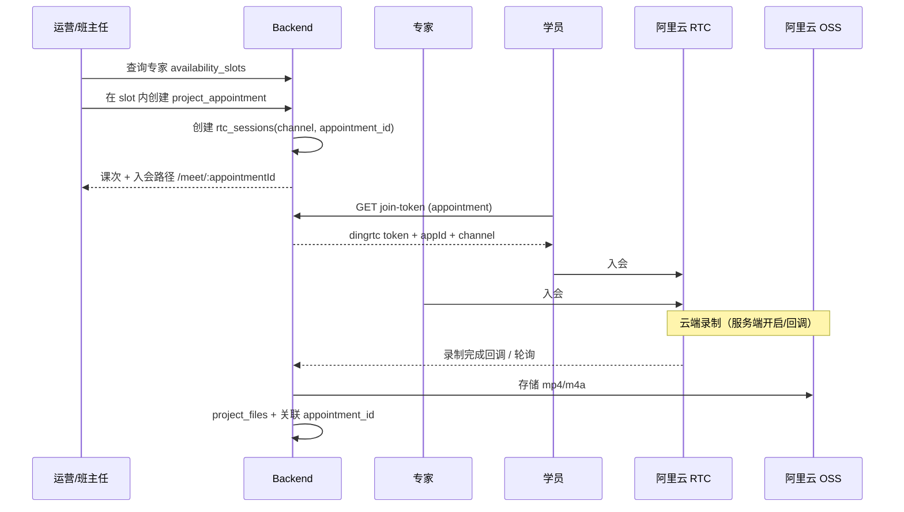

# 设计：运营选档 → RTC 入会 → 云录制 OSS

- **依据**: [PO 决策](./20251019-po-decisions-log.md) Q-P2-02 / Q-P2-02a
- **现状**: `backend/src/services/rtcService.ts` + `rtc_sessions.appointment_id`；Token 由服务端签发；**无**运营选 slot UI、**无**课次绑定自动建频道、**无**云端录制落 OSS

## 1. 用户流程（目标）

## 2. 与 Phase 2 已交付的差异

| 能力 | 当前实现 | 目标 |
|------|----------|------|
| 排课 | 运营手填 datetime | 从 **expert_availability_slots** 选 slot，校验 blackout |
| 入会 | `meeting_url` 外链 或 独立 RTC 呼叫 | **课次详情「进入教室」** → 平台 RTC 页 |
| 录制 | 无 | RTC 云端录制 → OSS；元数据入库 |
| 完成 | 专家/运营双确认时间戳 | 同左 + **运营确认后课次入账** |

## 3. API 草案（FEAT-P2-RTC）

| Method | Path | 说明 |
|--------|------|------|
| GET | `/ops/experts/:id/availability` | slots + blackouts（已有 schedule 数据，需 ops 聚合） |
| POST | `/ops/projects/:id/appointments/from-slot` | `{ slotWeekday, startTime, endTime, date }` 或 `{ startAt, endAt }` 且校验落在 slot 内 |
| POST | `/appointments/:id/rtc/prepare` | 创建/绑定 `rtc_sessions`，返回 `joinPath` |
| POST | `/appointments/:id/join-token` | expert / student / ops 旁听（可选） |
| POST | `/internal/rtc/recording-callback` | 录制结束，写 OSS key |
| GET | `/appointments/:id/recordings` | 回放列表 |

## 4. 数据（增量，需 migration + Human Approval）

- `project_appointments.rtc_session_id` 或沿用 `rtc_sessions.appointment_id`（已有）
- `rtc_recordings`: `id`, `rtc_session_id`, `appointment_id`, `oss_key`, `duration_sec`, `status`
- `income_lines.appointment_id`（nullable）— 课次入账防重复

## 5. 前端

- **ops** `ScheduleManagement`: 选专家 → 日历/slot  picker → 创建课次
- **student/expert** `MeetingRoom` 页：加载 `@dingrtc` Web SDK，用 join-token 入会
- 课次列表「进入教室」取代纯外链（保留 `meeting_url` 作降级/调试）

## 6. 测试

- 集成：mock RTC 配置下 prepare + join-token；录制回调写库（stub）
- E2E：staging 真 RTC 冒烟（可选 nightly）

## 7. 环境

沿用 `backend/.env.example` 中 RTC + OSS；录制需额外 RAM/录制模板 ID（阿里云控制台配置，**部署前 Human Approval**）。
